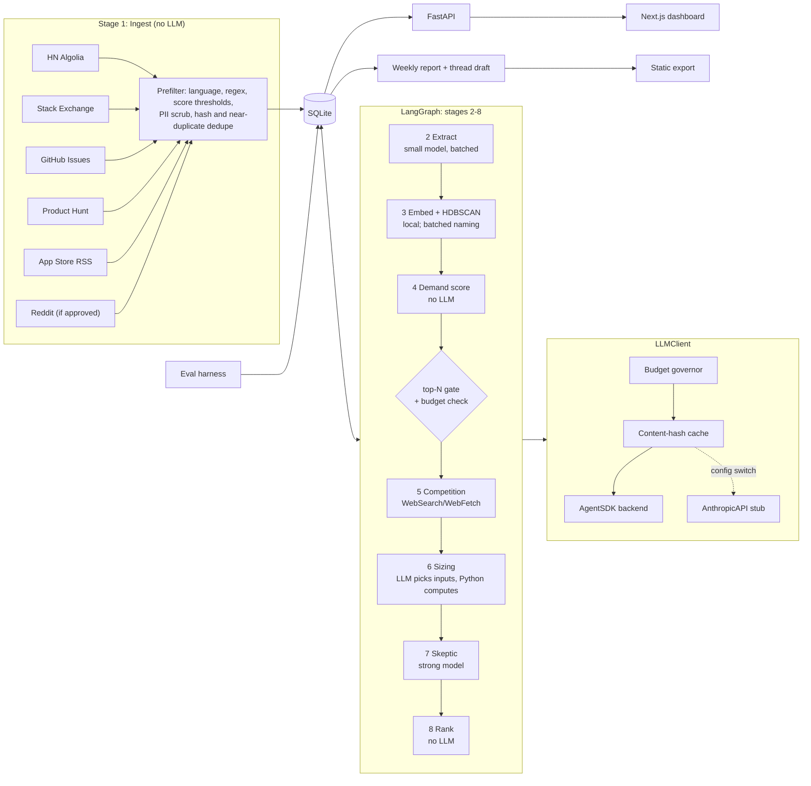

# Idea Radar: Plan

> Status: **draft, awaiting approval**. No code has been written yet.
> Last updated: 2026-11-15

Idea Radar scans public discussions for real, unmet problems. It scores how much demand each problem has and how crowded its space is, sizes the opportunity with every number backed by a source or a labeled assumption, asks a skeptic agent to try to kill it, and outputs a ranked list where every result links back to its evidence.

It is a single-user tool that runs on one Claude Pro subscription. Token efficiency is a core requirement, not a later optimization.

---

## 1. What I verified in the docs (Claude Agent SDK, Python)

I read the official docs at code.claude.com/docs/en/agent-sdk on 2026-11-15. These facts shape the design:

| Fact | Design consequence |
|---|---|
| `query(prompt=..., options=ClaudeAgentOptions(...))` returns an async iterator of messages. The final one is a `ResultMessage`. | One `query()` call per batch. No long-lived sessions. |
| `ClaudeAgentOptions` has `model`, `fallback_model`, `system_prompt`, `tools`, `allowed_tools`, `disallowed_tools`, `max_turns`, `max_budget_usd`, `output_format`, `effort`, `setting_sources`, `cwd`, `env`, `permission_mode`. | All are set explicitly in one place (`llm/agent_sdk.py`). |
| **By default `query()` loads user and project settings, including every CLAUDE.md, into the conversation.** | Pipeline calls set `setting_sources=[]` and run with `cwd` set to an empty scratch directory. Otherwise this repo's CLAUDE.md would be billed on every call. |
| When `system_prompt` is not set, the SDK uses a minimal prompt. A plain string replaces it completely. | Short custom system prompts, stored as versioned files. |
| Structured output: `output_format={"type": "json_schema", "schema": ...}`. The model answers through a `StructuredOutput` tool call. The SDK validates the answer and re-prompts on mismatch. The data is in `ResultMessage.structured_output`. Failure subtype: `error_max_structured_output_retries`. | Small, flat schemas, because each validation failure costs another turn. `max_turns` is small but at least 2. Pydantic models generate the schemas. |
| `ResultMessage` has `usage`, `model_usage`, `total_cost_usd` (a client-side estimate), `is_error`, `subtype`, `stop_reason`, `terminal_reason`, `api_error_status`. | Every call is logged with token counts and an "API-equivalent cost" shown in the budget panel. |
| Rate limits arrive as a **`RateLimitEvent`** with `rate_limit_info.status` set to `allowed`, `allowed_warning` or `rejected`, plus `resets_at` and `utilization`. `AssistantMessage.error` can also be `"rate_limit"`. | The budget governor listens for these events: it stops early on `allowed_warning` and saves state and exits on `rejected`. |
| Errors: `ClaudeSDKError` > `CLIConnectionError` > `CLINotFoundError`; `ProcessError` > `ResultError` (has `subtype`, `api_error_status`, `terminal_reason`); `CLIJSONDecodeError`. | The retry policy branches on these error types, never on message text. |
| Built-in tools include `WebSearch` and `WebFetch`. | Only the competition stage gets these tools. Every other stage runs with no tools. |
| **Policy note (overview page):** "Unless previously approved, Anthropic does not allow third party developers to offer claude.ai login or rate limits for their products, including agents built on the Claude Agent SDK." | Idea Radar only ever runs locally under your own login and is never offered to anyone else. The README will say that anyone who forks it must use their own API key backend. See Risks. |

Exact signatures will be checked again against the installed SDK version at the start of M1. The SDK version is pinned.

---

## 2. Changes to your defaults (with reasons)

| Default | Proposal | Why |
|---|---|---|
| `hdbscan` package | **`sklearn.cluster.HDBSCAN`** (scikit-learn ≥ 1.3) | The `hdbscan` package often needs a C compiler on Windows. The scikit-learn version ships prebuilt wheels and has the same algorithm. |
| sentence-transformers | **`fastembed`** (ONNX, `BAAI/bge-small-en-v1.5`) behind an `Embedder` interface | No PyTorch: roughly 100 MB installed instead of about 2 GB, and fast on CPU. sentence-transformers stays available as a config option. |
| Raw SQLite | **SQLAlchemy 2.0 + Alembic** on SQLite | The same models and migrations run on Postgres later. Vectors are stored as float32 blobs, with brute-force NumPy cosine similarity (fine up to about 100k vectors). Moving to pgvector later touches one repository class. |
| One LLM call per cluster for naming | **8 to 10 clusters per naming call**, and only for clusters whose membership changed by more than 25% | Same quality, about 8x fewer calls. Stable clusters keep their names. |
| Sizing is an LLM output | **The LLM chooses inputs, Python does the arithmetic.** The LLM returns line items (population, share affected, price, conversion), each tied to a source or a labeled assumption. Python computes TAM/SAM/SOM low/base/high. | The model never invents a total and never makes arithmetic mistakes. A validator rejects any line item that has neither a source nor an assumption. |
| Web access only in stage 5 | Stage 5 also collects **market facts** (claim, value, source URL, quote) that stage 6 is allowed to cite | Sizing needs real numbers, and the web stays in one stage. Stage 6 can only cite stored facts or declare assumptions. |
| Google Play reviews | **Apple App Store customer-reviews RSS feed**, with Google Play disabled by default | Google has no official API for other apps' reviews. Scraping violates Google Play's terms. Apple publishes a public reviews RSS feed. (Question 2.) |
| Reddit as a core source | Build the adapter, but **gate it on credentials**. Add **Stack Exchange** and **GitHub Issues** as official, free sources. | Since November 2025, Reddit requires manual approval for new API access, and personal scripts are reportedly often denied. (Question 1.) |
| Separate static export | **The Next.js app builds two ways:** a live build reading FastAPI, and a static build (`output: 'export'`) reading a frozen JSON snapshot | One codebase. The public report is the same UI with no LLM or API behind it. |
| (not specified) | `uv` for environments, Typer CLI, structlog (JSON logs), pydantic v2, pytest, ruff, mypy | Standard, fast, typed. |

Everything else stays as you specified: Python 3.12, FastAPI, LangGraph, Next.js + Tailwind, YAML config.

---

## 3. Architecture



### Run model
- `radar ingest` runs stage 1 only. It uses no LLM, so it can run often (for example every 6 hours).
- `radar run` runs the graph (stages 2 to 8) under a call budget. It is meant to run nightly.
- Every stage is **idempotent against the database**. It processes only rows in a `pending` state for the current prompt and model version. A run that stops because of the budget or a rate limit simply continues on the next run. A LangGraph SQLite checkpointer keyed by `run_id` lets a resumed run skip nodes that already finished.
- Graph state holds **IDs and counters only**, never item text. Checkpoints stay small and the database stays the single source of truth.

### Budget-aware graph edges
After every LLM-using node, a conditional edge checks the governor. If the budget is exhausted or a limit was hit, the graph goes straight to `finalize`, which records the run status and exits with code 75 (temporary failure). The next scheduled run resumes from there.

---

## 4. LLM layer and token budget

### Interface
```python
class LLMClient(Protocol):
    async def complete_json(
        self, *, task: str, model_tier: Literal["small", "strong"],
        system: str, prompt: str, schema: type[BaseModel],
        tools: Sequence[str] = (), max_turns: int = 2,
    ) -> LLMResult[BaseModel]: ...
```
Backends: `AgentSDKBackend` (default), `AnthropicAPIBackend` (a stub that raises NotImplemented until enabled), and `FakeBackend` (replays recorded JSON so tests never call a model). Model tiers map to aliases in YAML (`small: haiku`, `strong: sonnet`), so models change by config only.

### Guards
- **API key guard:** if `ANTHROPIC_API_KEY` is set and the backend is `agent_sdk`, the run **refuses to start** and prints how to unset the variable, because the SDK would bill the API instead of your plan. `radar doctor` checks this, plus CLI login status and the configuration.
- Calls run with `setting_sources=[]`, `cwd=<empty scratch dir>`, a short custom `system_prompt`, and `tools=[]` (except in stage 5). This keeps each call's fixed overhead minimal. M1 measures that overhead with one smoke call.
- Scraped text is wrapped as delimited data, and the system prompt says it is untrusted. Stages without tools cannot act on injected instructions, and stage 5's tools are read-only web tools.

### Token-efficiency stack, in order
1. **Free filtering first:** language detection, regex problem and willingness-to-pay patterns ("I wish there was", "is there a tool", "I'd pay", "switching from", "alternative to"...), negative patterns (job posts, self-promotion), per-source score thresholds, length bounds, exact-hash and embedding near-duplicate dedupe. Items are ranked by prefilter score, and only the top K reach the LLM, where K = the remaining extraction budget × batch size.
2. **Batching:** 25 items per extraction call, snippets capped at about 400 characters. Output lists **only the items that are problems**; the others are omitted rather than echoed. Short JSON keys.
3. **Cache:** key = sha256(backend, model, prompt version, schema hash, normalized input). A cache hit costs zero calls. Changing a prompt version invalidates only that stage.
4. **Model tiering:** `small` (Haiku, `effort="low"`) for extraction and naming; `strong` (Sonnet) for competition, sizing and skeptic.
5. **Top-N gate:** stages 5 to 7 run only for the top N clusters by demand (default 3 per run), and only when a cluster is new, changed materially, or its analysis is older than 30 days.
6. **Governor:** a per-run `max_llm_calls` with per-stage sub-budgets, plus `max_budget_usd` per call as a safety ceiling.

### Example nightly budget (defaults, all in YAML)
| Stage | Calls | Throughput |
|---|---|---|
| Extraction | 10 | about 250 prefiltered items |
| Cluster naming | 2 | up to 20 changed clusters |
| Competition (multi-turn, web) | 3 | top 3 clusters |
| Sizing | 3 (or 1 batched) | top 3 |
| Skeptic | 3 | top 3 |
| **Total** | **≤ 21** | |

### Rate limits and resume
- `RateLimitEvent` with `allowed_warning`: finish the current call, then stop cleanly. This leaves headroom for your own use of Claude (configurable).
- `rejected`, or an error result with status 429: no retry. Save `resets_at` and exit with code 75. The next run exits immediately if it starts before `resets_at`.
- 5xx and overloaded errors: up to 3 exponential backoffs with jitter.
- Every call is written to `llm_calls` (stage, model, item count, tokens, cache hits, duration, estimated cost, status). This table feeds the budget panel.

---

## 5. Data model (SQLite via SQLAlchemy; Postgres-ready)

| Table | Key columns |
|---|---|
| `raw_items` | `id` (hash of source and source ID), `source`, `source_id`, `url`, `title`, `snippet` (≤ 500 characters, PII scrubbed), `context` (for example the parent thread title), `created_at`, `fetched_at`, `score`, `num_comments`, `lang`, `content_hash`, `prefilter_score`, `prefilter_status`, `prefilter_reasons`. **No usernames are stored.** |
| `ingest_cursors` | `source`, `key`, `value`, `updated_at` (makes ingest incremental) |
| `llm_cache` | `key`, `response_json`, `model`, `prompt_version`, `created_at` |
| `llm_calls` | `id`, `run_id`, `stage`, `model`, `n_items`, `input_tokens`, `output_tokens`, `cache_read_tokens`, `cost_usd_est`, `duration_ms`, `status`, `error`, `created_at` |
| `runs` | `id`, `kind`, `started_at`, `finished_at`, `status` (completed, budget_exhausted, rate_limited, error), `calls_used`, `config_hash`, `resets_at` |
| `problems` | `id`, `raw_item_id`, `who`, `problem`, `workaround`, `urgency` (1 to 5), `wtp_signals` (JSON), `wtp_strength` (0 to 1), `quote` (a short verbatim span), `extractor_version` |
| `rejections` | `raw_item_id`, `extractor_version` (items the LLM judged not to be problems, so they are never resent) |
| `embeddings` | `owner_type`, `owner_id`, `model`, `vector` (blob) |
| `clusters` | `id`, `name`, `summary`, `status` (active or merged), `merged_into`, `centroid`, `member_signature`, `named_at`, `created_at` |
| `cluster_members` | `cluster_id`, `problem_id`, `similarity`, `assigned_at` |
| `demand_scores` | `cluster_id`, `run_id`, `volume`, `trend`, `recency`, `engagement`, `wtp`, `corroboration`, `score`, `weekly_counts` (JSON, feeds the trend chart) |
| `competitors` | `cluster_id`, `name`, `url`, `positioning`, `pricing_hint`, `complaints`, `evidence_urls` |
| `competition` | `cluster_id`, `run_id`, `crowdedness`, `dissatisfaction`, `score`, `rationale`, `searched_at` |
| `market_facts` | `id`, `cluster_id`, `claim`, `value`, `unit`, `source_url`, `quote`, `retrieved_at` |
| `sizing` | `cluster_id`, `run_id`, `line_items` (JSON: label, low/base/high, unit, basis = `fact`/`assumption`, `fact_id` or assumption text, confidence), computed `tam`/`sam`/`som` low/base/high, `monetization`, `feasibility`, rationale |
| `skeptic_reviews` | `cluster_id`, `run_id`, `verdict` (kill, weak or survives), `objections` (JSON), `what_would_change_my_mind`, `confidence` |
| `opportunities` | `cluster_id`, `run_id`, `demand`, `competition`, `monetization`, `feasibility`, `score`, `rank`, `breakdown` (JSON) |
| `reports` | `week`, `markdown`, `x_thread`, `reddit_post`, `snapshot_json`, `created_at` |

### Clustering across time
New problems are embedded and **assigned to an existing cluster** when cosine similarity to its centroid is at least τ_assign (0.78). The rest go to an unassigned pool, and HDBSCAN runs on that pool once it reaches a minimum size. Clusters whose centroids are at least τ_merge (0.88) similar are **merged**: the old ID is kept with `merged_into`, so links never break. Cluster IDs stay stable, and renaming happens only on a large membership change.

### Scores (all in [0, 1], weights in YAML, breakdown stored)
- **Demand** is a weighted sum of percentile-ranked components:
  - volume: log of distinct items
  - trend: last 4 weeks compared with the prior 4, shrunk toward neutral at low counts
  - recency: exponential decay with a 30-day half-life
  - engagement: per-source z-scored points and comments, because HN points are not comparable to Reddit votes
  - wtp: share and strength of willingness-to-pay signals
  - corroboration: number of distinct sources and threads
- **Competition** = f(crowdedness, incumbent dissatisfaction). A crowded space where users hate the incumbents scores lower (better) than a crowded, satisfied one.
- **Monetization** comes from the sizing stage: SOM base value, price-point evidence and WTP signals.
- **Feasibility** comes from a rubric the sizing call fills in: build complexity, regulation, data access, distribution. Each item is scored with a one-line reason.
- **Opportunity** = demand × (1 − competition) × monetization × feasibility. Each factor is floored at 0.05 so one noisy zero cannot hide a result; the unfloored values are also shown. The skeptic verdict is shown next to the score and can be filtered on, but it is not folded into the formula, so the formula stays transparent.

---

## 6. Folder structure

```
idea-radar/
├── PLAN.md  README.md  CLAUDE.md  pyproject.toml  uv.lock  .env.example
├── config/
│   ├── default.yaml          # budgets, models, thresholds, weights
│   └── sources.yaml          # per-source queries, tags, apps, limits
├── src/idea_radar/
│   ├── cli.py                # Typer: doctor, db, ingest, run, report, eval, serve, budget
│   ├── config.py  logging.py
│   ├── db/                   # models.py, session.py, repositories/, alembic/
│   ├── llm/
│   │   ├── client.py         # LLMClient protocol, LLMResult
│   │   ├── agent_sdk.py      # default backend
│   │   ├── anthropic_api.py  # stub
│   │   ├── fake.py           # test backend
│   │   ├── governor.py  cache.py  errors.py
│   │   └── prompts/          # extract.v1.md, name_clusters.v1.md, ...
│   ├── ingest/               # base.py, hn.py, stackexchange.py, github.py,
│   │                         # producthunt.py, appstore.py, reddit.py, prefilter.py, pii.py
│   ├── embed/                # embedder.py (fastembed / sentence-transformers)
│   ├── pipeline/
│   │   ├── state.py  graph.py
│   │   └── nodes/            # extract.py, cluster.py, demand.py, competition.py,
│   │                         # sizing.py, skeptic.py, rank.py, finalize.py
│   ├── scoring/              # demand.py, opportunity.py, sizing_math.py (pure functions)
│   ├── report/               # weekly.py, thread.py, snapshot.py
│   └── api/                  # FastAPI app, routers, response schemas
├── web/                      # Next.js + Tailwind (live and static builds)
├── evals/
│   ├── data/                 # extraction_gold.jsonl, cluster_pairs.jsonl, cluster_gold.jsonl
│   ├── label.py              # terminal labeling tool
│   └── run_evals.py          # metrics -> evals/results/*.json + README table
├── scripts/                  # schedule_windows.ps1, cron.example
├── tests/                    # unit tests (FakeBackend, fixtures, no network)
├── docs/BUILD_LOG.md
└── data/                     # gitignored: radar.db, cache, checkpoints
```

---

## 7. Eval harness

| Eval | Gold data | Metrics | LLM cost |
|---|---|---|---|
| **Extraction** | About 200 real ingested items, hand-labeled with `radar eval label` (is_problem, has_wtp, a short "who") | Precision, recall and F1 for is_problem; precision of WTP; coverage of the "who" field | About 8 calls, then cached per prompt version |
| **Prefilter recall** | The same 200 items | Share of true problems the free prefilter drops (cost against recall) | 0 |
| **Clustering** | About 150 labeled pairs (same or different problem) plus about 100 problems in gold groups | Pairwise precision, recall and F1; adjusted Rand index; noise ratio; silhouette | 0 (local embeddings) |
| **Sizing integrity** | Every sizing output | Share of line items with a valid `fact_id` or explicit assumption (target 100%); share of fact URLs still reachable | 0 |

Results are saved as JSON and rendered into a README table with the date, prompt version and model. Evals run only when you ask for them.

---

## 8. Milestones

Each milestone ends in a state you can run, with the exact commands. I stop after each one.

| # | Milestone | Ends with | LLM calls to verify |
|---|---|---|---|
| **M0** | Skeleton: uv project, config, logging, SQLAlchemy + Alembic, Typer CLI, `radar doctor`, CI (ruff, mypy, pytest), README with diagram, BUILD_LOG | `radar doctor` and `radar db init` work; tests pass | 0 |
| **M1** | LLM layer: `LLMClient`, AgentSDK backend, API stub, FakeBackend, cache, governor, rate-limit handling, call log | `radar llm smoke` makes 1 tiny call and prints the overhead tokens; unit tests use FakeBackend | 1 |
| **M2** | Ingest + prefilter: HN, Stack Exchange, GitHub Issues, Product Hunt, App Store RSS; Reddit adapter gated on credentials; dedupe; PII scrub | `radar ingest` fills the database; `radar ingest stats` | 0 |
| **M3** | Extraction stage + labeling tool + extraction and prefilter evals | `radar eval label`, `radar run --stages extract`, `radar eval extraction` | About 10 |
| **M4** | Embeddings, incremental clustering, batched naming, demand score, LangGraph wiring for stages 2 to 4, cluster eval | `radar run --until demand`, `radar eval clusters` | About 3 |
| **M5** | Competition (web tools), market facts, sizing (Python math), skeptic, ranking, top-N gate, full graph with resume | `radar run` end to end; resumes after a forced stop | About 10 |
| **M6** | FastAPI + Next.js dashboard: ranked list, evidence, trend chart, sizing breakdown, skeptic verdict, budget panel | `radar serve` + `npm run dev` | 0 |
| **M7** | Weekly report, X and Reddit thread draft, static export, Windows Task Scheduler setup | `radar report weekly`, `npm run build:static` | 0 to 1 |
| **M8** | Hardening: eval metrics in README, Postgres/pgvector migration notes, docs polish | Final README | 0 |

---

## 9. Risks

| Risk | Mitigation |
|---|---|
| **Subscription login policy.** The SDK docs say third-party developers may not *offer* claude.ai login in their products without approval. You run this yourself, for yourself, which is a different situation, but read the current terms before you rely on it. | Local, single-user use only. No hosted endpoint ever triggers an LLM call. The static export contains no LLM. The README tells anyone who forks it to use the API backend with their own key. |
| **Pro limits are small and shared with your Claude Code work.** | Call budgets, stop on `allowed_warning`, clean exit on `rejected`, nightly schedule, the cache, the top-N gate. |
| `ANTHROPIC_API_KEY` set by accident silently bills the API | Hard refusal at startup, a `radar doctor` check, and a warning in the README. |
| SDK API drift | Pinned version; all SDK code lives in one file; docs re-checked at M1. |
| Fixed per-call overhead (subprocess start, base prompt) | Measured in M1; batching amortizes it; no settings, CLAUDE.md or tools are loaded. |
| Structured-output retries burn extra turns | Small flat schemas; `max_turns` cap; failures are logged and the batch is split in half once. |
| Hallucinated market statistics | Sizing may cite only stored facts that have URLs, or it must declare assumptions. Python does the math. A validator enforces both. |
| Reddit access is denied | Reddit is optional; Stack Exchange and GitHub Issues cover the gap. |
| **Source bias:** HN, Stack Exchange and GitHub skew toward developers | Results are labeled "demand observed in these sources", and corroboration across sources counts. Consumer sources are configurable. |
| Prompt injection from scraped text or web pages | Scraped text is treated as data; most stages have no tools; stage 5 has read-only web tools; outputs are schema-validated. |
| Cluster drift and unstable IDs | Incremental assignment, merge records, stable IDs. |
| Windows install friction | scikit-learn HDBSCAN + fastembed (no compiler, no torch); PowerShell commands provided. |
| A public repo leaks data | `data/` is gitignored; reports contain only short quotes and links; no usernames are stored. |

---

## 10. Terms of service notes (check before each source goes live)

- **Hacker News (Algolia API):** public, no auth. Throttled to 1 request per second or less. Links back to every item.
- **Reddit Data API:** OAuth, a unique User-Agent, 100 requests per minute. Since November 2025 the Responsible Builder Policy requires approval for new access. The terms require removing content users delete, so Idea Radar stores snippets only and purges items older than 90 days (configurable).
- **Product Hunt API v2:** free developer token; non-commercial use by default; fair-use rate limits. A personal research tool fits; anything commercial needs their permission.
- **Google Play:** no official API for other apps' reviews (the Developer API covers only your own apps). Scraping libraries break the Play terms, so this source is off by default.
- **Apple App Store:** public customer-reviews RSS/JSON feed per app and country; polled politely; snippets and links only.
- **Stack Exchange API:** free key, 10k requests per day, CC BY-SA, so attribution and links are required (already part of the design).
- **GitHub REST/Search API:** authenticated token; search is limited to about 30 requests per minute; issues labeled `feature-request` or `enhancement` are a strong problem signal.
- **General:** short snippets with links, no PII, no usernames, polite rate limits, identifying User-Agent (generic project name, no personal email).

---

## 11. Open questions (answer these with your approval)

1. **Reddit and Product Hunt access:** do you already have Reddit API credentials (a script app created before November 2025), or should Reddit stay credential-gated with Stack Exchange and GitHub Issues as the main sources? Do you have, or can you create, a Product Hunt developer token?
2. **App reviews:** replace Google Play with the Apple App Store reviews feed (my recommendation), keep a Google Play scraper that is off by default, or drop app reviews?
3. **Domain focus:** scan broadly, or focus on a niche (for example dev tools, B2B SaaS for small businesses, or prosumer apps)? This sets the default queries, Stack Exchange sites, GitHub repos, apps and prefilter keywords. A focus also tends to produce sharper results and makes a better build-in-public story.
4. **Usage headroom:** how much of your Pro usage can a nightly run take? My default is at most 21 calls per run and a clean stop at the first `allowed_warning`, leaving the rest for your own Claude Code sessions.
