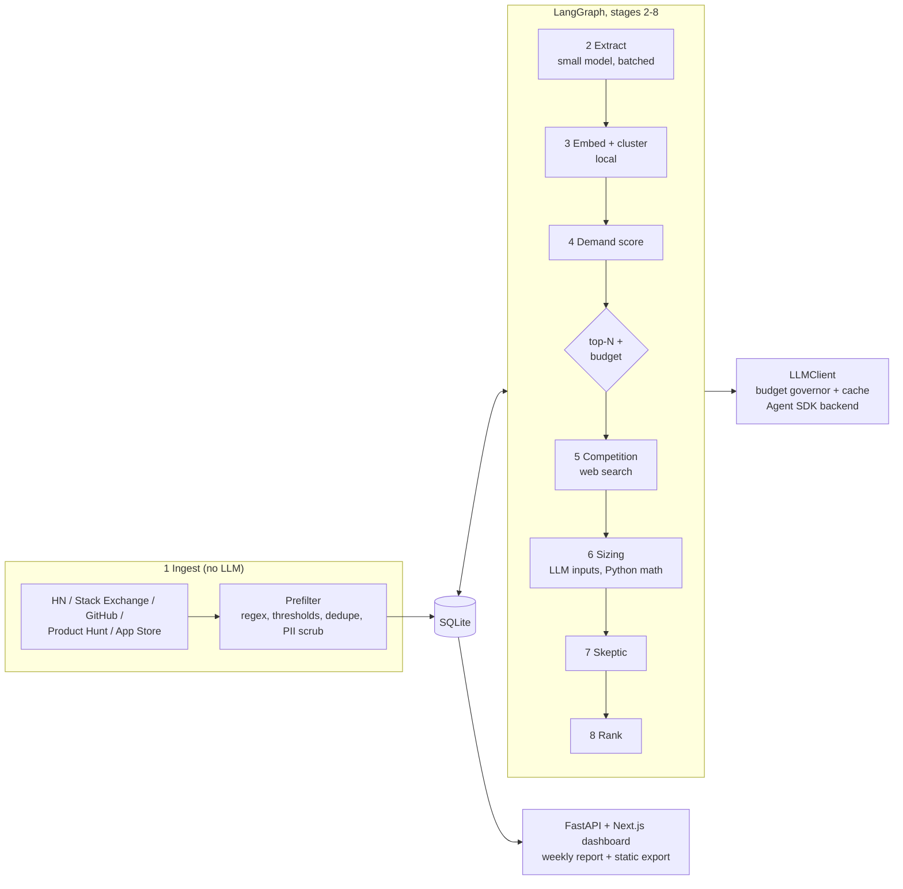

# Idea Radar

> **Status: M1, the LLM layer, is done.** Next up is M2, ingestion. Design: [PLAN.md](PLAN.md). Progress: [docs/BUILD_LOG.md](docs/BUILD_LOG.md).

Idea Radar scans public discussions (Hacker News, Stack Exchange, GitHub Issues, Product Hunt, App Store reviews) for real, unmet problems. It then:

1. scores demand and competition for each problem,
2. sizes the business opportunity (TAM/SAM/SOM, where every number cites a source or is labeled as an assumption),
3. asks a skeptic agent to try to kill it,
4. outputs a ranked, evidence-backed list.

It's a multi-stage agentic data pipeline (LangGraph) with evals, designed to run nightly in small batches on a single Claude Pro subscription. The current focus is **developer tools and B2B SaaS for small teams**; change it in `config/default.yaml`.

## Architecture



## ⚠️ LLM access: read this before running

- Idea Radar calls Claude through the **Claude Agent SDK, using the developer's own Claude subscription login**, for personal use only.
- **Do not set `ANTHROPIC_API_KEY` (or `ANTHROPIC_AUTH_TOKEN`).** If it is set, the SDK bills the API instead of your plan, and a Pro plan does not include API credits. Idea Radar refuses to start in that case, and `radar doctor` reports it.
- **If you fork this:** use the API backend with your own API key. Anthropic does not allow third-party developers to offer claude.ai login in their products without approval.

## Quickstart (Windows PowerShell)

```powershell
# 1. Install uv (once)
powershell -ExecutionPolicy ByPass -c "irm https://astral.sh/uv/install.ps1 | iex"

# 2. Install dependencies (uv fetches Python 3.12 if needed)
uv sync

# 3. Optional: keep the database outside OneDrive
Copy-Item .env.example .env   # then uncomment RADAR__APP__DATA_DIR

# 4. Check everything, then create the database
uv run radar doctor
uv run radar db init
```

## CLI

| Command | What it does | LLM calls |
|---|---|---|
| `radar doctor` | Checks Python, config, API-key safety, data dir, database, SDK | 0 |
| `radar config` | Prints the effective config (defaults + `config/local.yaml` + `RADAR__*` env) | 0 |
| `radar db init` | Creates or upgrades the schema (Alembic); safe to re-run | 0 |
| `radar db status` | Shows the current and latest revisions and the run count | 0 |
| `radar llm smoke` | Makes one tiny real call: checks subscription auth and measures per-call token overhead | **1** |
| `radar budget` | Lists recent runs with calls, cache hits, tokens and API-equivalent cost | 0 |
| `radar version` | Prints the version | 0 |

Exit code **75** means the run stopped cleanly because of its call budget or a Claude usage limit. The next scheduled run resumes, and it won't start before the limit resets.

## How LLM calls work

Every call goes through one `LLMClient`:

1. **Cache:** the key is a sha256 of the backend, model, effort, prompt version, schema and input. A cache hit is free.
2. **Budget:** the governor checks the per-run and per-stage call limits.
3. **Call:** the Agent SDK backend runs the request with no CLAUDE.md or settings, no tools, an empty sandbox folder as the working directory, a short system prompt, and a JSON-schema output.
4. **Retries:** only transient failures are retried (5xx, overloaded, timeouts), with exponential backoff.
5. **Validation:** the output is checked against a pydantic schema before it is cached.
6. **Logging:** each attempt is written to `llm_calls` with tokens, the credential that paid for it (`apiKeySource`), and the rate-limit state.
7. **Rate limits:** a warning stops the run after the current call; a rejection saves the reset time and exits with 75.

## Configuration

`config/default.yaml` holds every setting, with comments. Override settings in `config/local.yaml` (gitignored) or with env vars named like `RADAR__BUDGET__MAX_LLM_CALLS_PER_RUN=10`. Secrets for sources go in `.env` (see `.env.example`).

## Development

```powershell
uv run pytest        # tests never touch the network or an LLM
uv run ruff check .
uv run ruff format .
uv run mypy
```

## Evals

Coming in M3 and M4: extraction precision and recall, prefilter recall, and cluster pairwise F1 and ARI, measured on a hand-labeled set.

## License

TBD.
