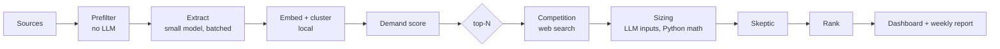

# Idea Radar

> **Status: planning.** No code yet. See [PLAN.md](PLAN.md) for the design and [docs/BUILD_LOG.md](docs/BUILD_LOG.md) for progress.

Idea Radar scans public discussions (Hacker News, Stack Exchange, GitHub Issues, Product Hunt, App Store reviews) for real, unmet problems. It then:

1. scores demand and competition for each problem,
2. sizes the business opportunity (TAM/SAM/SOM, where every number cites a source or is labeled as an assumption),
3. asks a skeptic agent to try to kill it,
4. outputs a ranked, evidence-backed list.

It's a multi-stage agentic data pipeline (LangGraph) with evals, designed to run nightly in small batches on a single Claude Pro subscription.

## ⚠️ LLM access: read this before running

- Idea Radar calls Claude through the **Claude Agent SDK, using the developer's own Claude subscription login**, for personal use only.
- **Do not set `ANTHROPIC_API_KEY`.** If it is set, the SDK bills the API instead of your plan. Idea Radar refuses to start in that case.
- **If you fork this:** use the API backend with your own API key. Anthropic does not allow third-party developers to offer claude.ai login in their products without approval.

## License

TBD.
